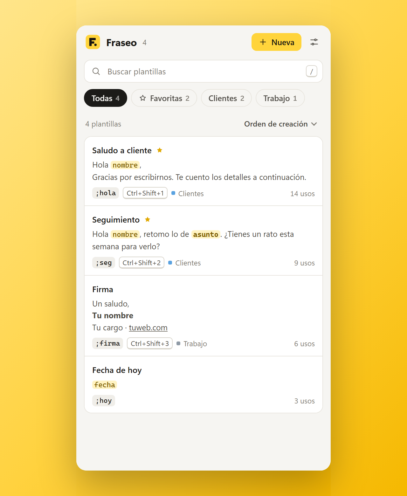
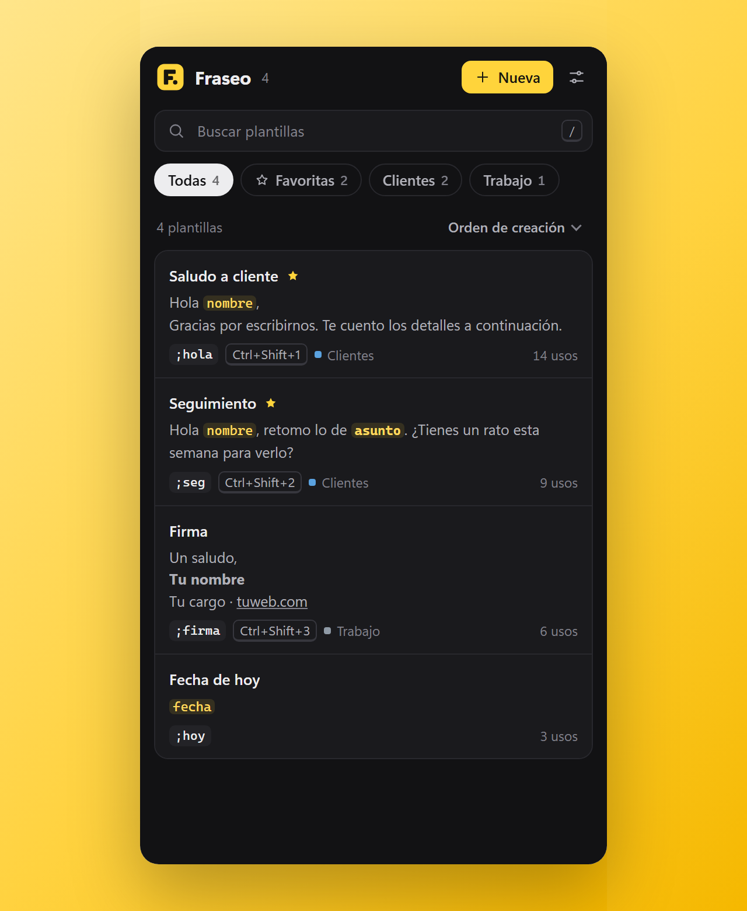
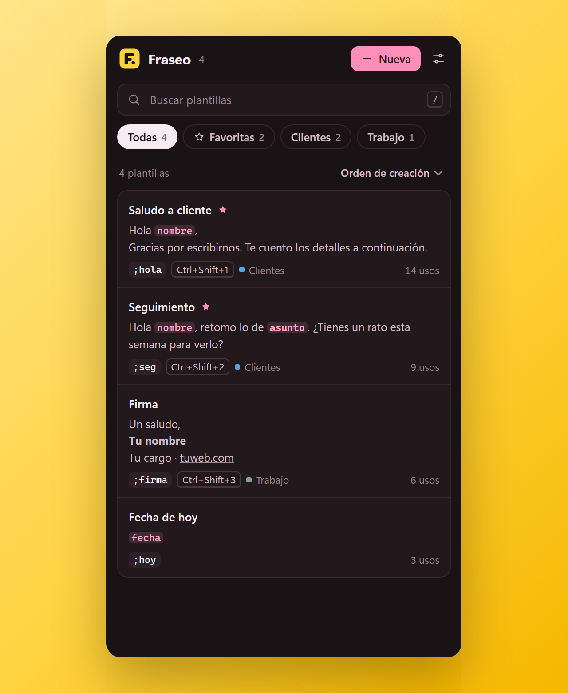
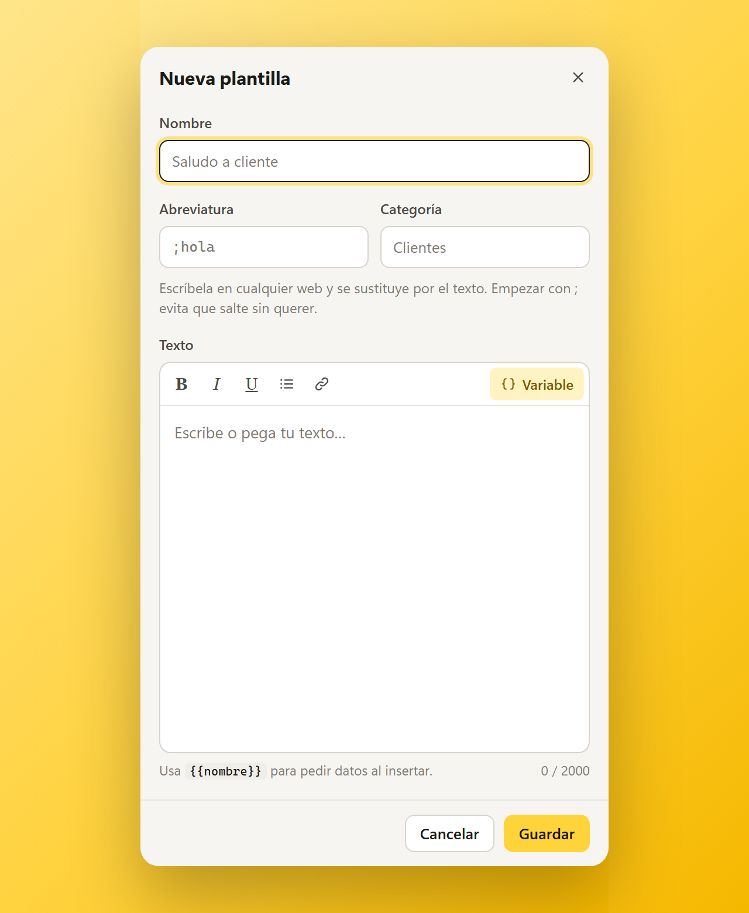
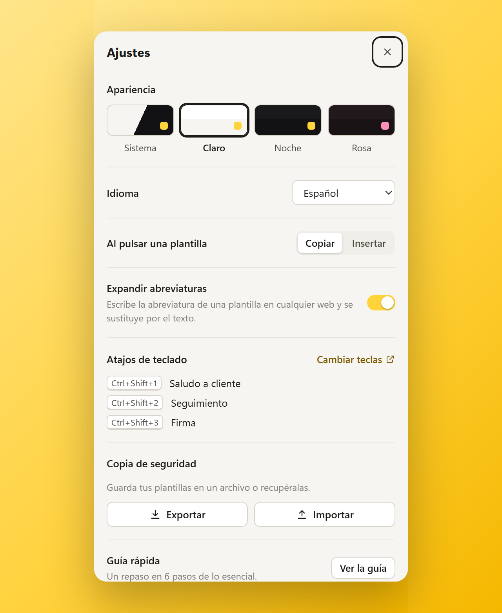
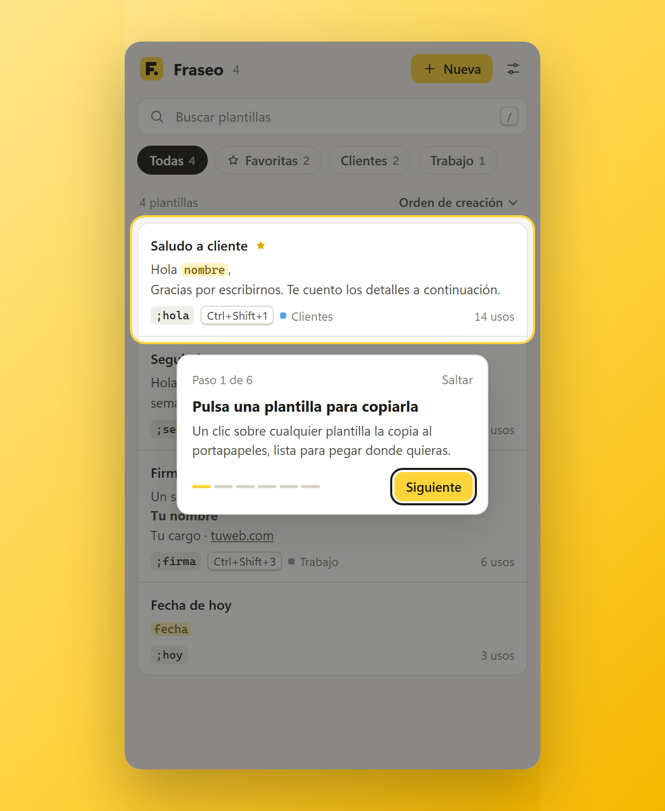

# Fraseo

> Este repositorio contiene la información y los paquetes de instalación. El código fuente es privado.

**Plantillas y abreviaturas de texto para Chrome.**

    

**[Capturas](#capturas)** · **[Funciones](#lo-esencial)** · **[Instalar](#instalar-en-chrome)** · **[Privacidad](#privacidad)** · **[Soporte](#soporte)**

---

**Fraseo** guarda los textos que escribes una y otra vez y los pega donde estés: con un clic desde el panel lateral de Chrome, con una abreviatura como `;hola` o con un atajo de teclado.

## Capturas

| El panel (tema claro) | Tema Noche | Tema Rosa |
|---|---|---|
|  |  |  |

| Editor de plantillas | Ajustes | Guía rápida |
|---|---|---|
|  |  |  |

## Lo esencial

- **Abreviaturas.** Asigna una abreviatura a una plantilla y escríbela en cualquier campo de texto de una web: se sustituye por el texto al instante. Funciona en campos normales, áreas de texto y editores enriquecidos basados en `contenteditable`, también dentro de iframes. Empezar con `;` evita que salten sin querer.
- **Campos para rellenar.** Escribe `{{nombre}}`, `{{empresa}}` o cualquier otro nombre entre dobles llaves. Al usar la plantilla, Fraseo pide esos datos (en el panel o en un pequeño formulario dentro de la propia web) y muestra una vista previa.
- **Variables automáticas.** `{{fecha}}`, `{{hora}}` y `{{día}}` se sustituyen por la fecha, la hora y el día de la semana actuales. También funcionan en inglés y francés (`{{date}}`, `{{time}}`, `{{weekday}}`, `{{heure}}`, `{{jour}}`).
- **Formato.** Negrita, cursiva, subrayado, listas y enlaces se conservan al insertar en editores que admiten formato y al copiar. En campos de texto plano se inserta la versión sin formato.
- **Organización.** Categorías como filtros, favoritas siempre arriba, búsqueda que ignora tildes y resalta coincidencias, y orden por creación, uso, edición reciente o nombre. Cada plantilla muestra cuántas veces la has usado.
- **Atajos.** Tres ranuras (`Ctrl + Shift + 1/2/3` por defecto) insertan la plantilla asignada en el campo activo. `Alt + Shift + F` abre el panel. Puedes cambiarlos en `chrome://extensions/shortcuts`.
- **Clic derecho.** En un campo editable, el menú de Fraseo muestra tus plantillas agrupadas por categoría. Sobre un texto seleccionado, **Guardar selección en Fraseo** lo convierte en plantilla y abre el editor para que le pongas nombre.

## Instalar en Chrome

1. Ve a **[Releases](../../releases/latest)** y descarga `fraseo-1.3.1.zip`.
2. Descomprime el ZIP en una carpeta que no vayas a borrar (Chrome la lee desde ahí).
3. Abre `chrome://extensions` y activa el **Modo de desarrollador**.
4. Pulsa **Cargar descomprimida** y selecciona la carpeta descomprimida.
5. Pulsa el icono de Fraseo para abrir el panel lateral. La primera vez puedes elegir idioma y empezar con plantillas de ejemplo.

Requiere Chrome 120 o posterior. Instalada así no se actualiza sola: descarga el ZIP del último Release, sustituye la carpeta y pulsa el botón de recargar en `chrome://extensions`.

## Usar el panel

- **Nueva** (o la tecla `N`) abre el editor. `/` enfoca la búsqueda; las flechas recorren la lista e `Intro` usa la plantilla seleccionada (`Mayús + Intro` hace la acción contraria).
- Al pasar el ratón por una plantilla aparecen **Insertar**, **Copiar** y **Más acciones** (favorita, editar, duplicar, copiar para la barra de Chrome, atajo de teclado y eliminar).
- Pulsar una plantilla la copia al instante, aunque tenga campos: los `{{campos}}` se copian tal cual, y fecha, hora y día ya resueltos. Para rellenar los campos antes de copiar, usa el botón **Copiar** de la tarjeta. En **Ajustes → Al pulsar una plantilla** puedes hacer que el clic inserte en lugar de copiar.
- Al eliminar una plantilla aparece **Deshacer** durante unos segundos.
- **Insertar** escribe en el último campo que usaste en la página, aunque el foco esté en el panel.

## Ajustes

- **Apariencia:** Sistema, Claro, Noche o Rosa.
- **Idioma:** español, inglés o francés.
- **Expandir abreviaturas:** actívalo o desactívalo en todas las webs.
- **Copia de seguridad:** exporta un JSON con tus plantillas (incluidas abreviaturas, categorías, favoritas y atajos) o impórtalo. Al importar puedes añadir sin duplicar o reemplazar la biblioteca. Las copias de versiones anteriores siguen siendo compatibles.

## Límites conocidos

- Chrome no permite que las extensiones escriban en sus páginas internas (`chrome://…`), en la Chrome Web Store ni en la barra de direcciones. Ahí usa **Copiar** o **Copiar para la barra de Chrome** (después `Ctrl + L`, `Ctrl + V`).
- Google Docs y otros editores que dibujan el texto en un lienzo no exponen campos de texto, así que las abreviaturas no se expanden allí. Copiar y pegar sí funciona.
- Una abreviatura no puede empezar igual que otra (por ejemplo `;sal` y `;saludo`), porque la más corta se expandiría antes de terminar de escribir la larga. El editor avisa del conflicto.
- Las abreviaturas no se expanden en campos de contraseña.

## Privacidad

**Resumen:** Fraseo no tiene cuentas, analítica, publicidad ni servidores propios, y no envía tus plantillas a nadie.

- Plantillas, preferencias y contador de uso se guardan en `chrome.storage.local`, solo en tu perfil de Chrome (no se sincronizan).
- Para detectar abreviaturas, Fraseo compara **en tu equipo** los últimos caracteres que escribes en un campo editable. No guarda ni envía lo que escribes, y ignora los campos de contraseña. Puedes desactivarlo en *Ajustes → Expandir abreviaturas*.
- Solo sale texto de tu equipo en dos casos: si confirmas una sugerencia desde la barra de direcciones (palabra clave `fraseo`), la consulta va a tu buscador predeterminado; y la web donde insertas una plantilla recibe el texto como si lo hubieras escrito.
- Quitar la extensión o borrar sus datos elimina las plantillas: exporta una copia de seguridad si quieres conservarlas.

Política completa: **[PRIVACY.md](PRIVACY.md)**.

## Permisos

| Permiso | Para qué |
|---|---|
| `storage` | Guardar plantillas, preferencias y contador de uso en tu navegador. |
| `sidePanel` | Mostrar el panel lateral. |
| `contextMenus` | Menú de clic derecho con tus plantillas. |
| `scripting` | Insertar el texto en la pestaña activa. |
| `clipboardWrite` | Copiar una plantilla al portapapeles. |
| `search` | Enviar al buscador la consulta de la barra de direcciones (`fraseo`). |
| `<all_urls>` | Detectar abreviaturas e insertar texto en cualquier web. |

## Soporte

¿Algo no funciona o tienes una duda? Hay tres vías, de la más rápida a la más completa:

1. **Preguntas frecuentes** (justo debajo): resuelven la mayoría de los casos.
2. **Una incidencia en GitHub**: [abre una aquí](https://github.com/dannymedinacoronel/Fraseo-Extension/issues/new?template=problema.md). Es la mejor opción para fallos, porque queda registrado y otros usuarios pueden verlo.
3. **Correo**: [empresademkor@gmail.com](mailto:empresademkor@gmail.com) para consultas privadas, privacidad o sugerencias.

**Para poder ayudarte rápido, incluye:** la versión de Fraseo (en `chrome://extensions`), tu versión de Chrome (`chrome://settings/help`), tu sistema operativo, qué esperabas que pasara y qué pasó, y los pasos para repetirlo. No envíes contraseñas ni datos personales.

### Preguntas frecuentes

<b>La abreviatura no se expande</b>

Comprueba que **Expandir abreviaturas** esté activado en Ajustes, que escribas la abreviatura exacta (mejor si empieza por `;`) en un campo de texto normal y que la extensión tenga acceso a la web (`chrome://extensions` → Detalles → Acceso al sitio). No funciona en campos de contraseña, en páginas internas de Chrome (`chrome://…`) ni en la Chrome Web Store.

<b>Una abreviatura salta sin querer o no llega a completarse</b>

Una abreviatura no puede empezar igual que otra (por ejemplo `;sal` y `;saludo`), porque la corta se expandiría antes de terminar de escribir la larga. El editor te avisa del conflicto. Empezar con `;` evita que salten al escribir texto normal.

<b>No funciona en Google Docs ni en otros editores de lienzo</b>

Esos editores dibujan el texto en un lienzo y no exponen campos de texto, así que las abreviaturas no se expanden allí. **Copiar** y pegar sí funciona.

<b>No puedo insertar en la barra de direcciones ni en `chrome://…`</b>

Chrome no permite que las extensiones escriban ahí. Usa **Copiar** o **Copiar para la barra de Chrome** y pega con `Ctrl+L`, `Ctrl+V`.

<b>He perdido mis plantillas</b>

Se guardan en el almacenamiento local de la extensión: al desinstalarla o borrar sus datos desaparecen. Exporta de vez en cuando una copia en *Ajustes → Exportar* y recupérala con *Importar* (puedes añadir sin duplicar o reemplazar).

<b>¿Cómo cambio los atajos de teclado?</b>

En `chrome://extensions/shortcuts`. Por defecto: `Ctrl+Shift+1/2/3` insertan las plantillas asignadas y `Alt+Shift+F` abre el panel.

<b>¿Cuesta algo? ¿Funciona en otros navegadores?</b>

Es gratis. Está pensada para Google Chrome 120 o posterior; puede funcionar en navegadores basados en Chromium, pero no está probada en ellos.

<b>Cómo actualizar a una versión nueva</b>

Descarga el ZIP del [último Release](https://github.com/dannymedinacoronel/Fraseo-Extension/releases/latest), sustituye la carpeta anterior y pulsa el botón de recargar de Fraseo en `chrome://extensions`. Tus plantillas se conservan.

## Autor

Danny Medina Coronel · empresademkor@gmail.com

© 2026 Danny Medina Coronel. Todos los derechos reservados.
